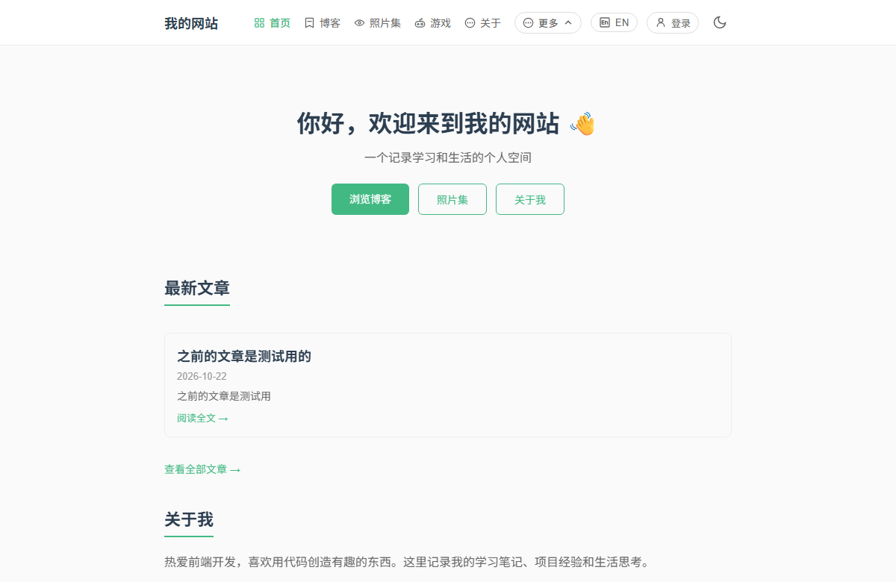
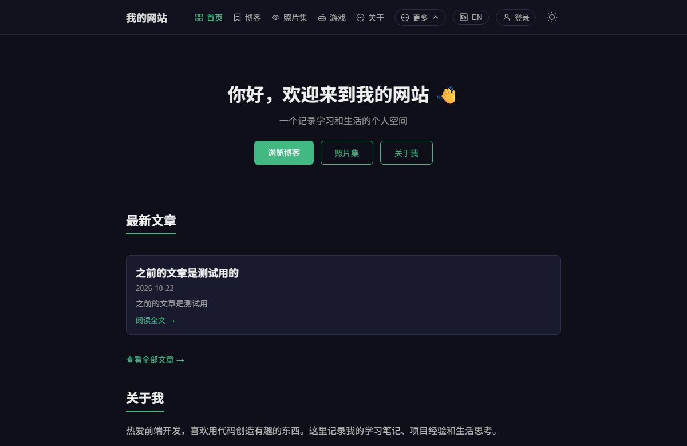
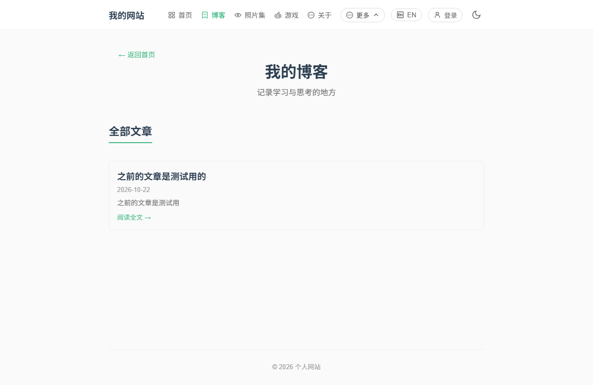
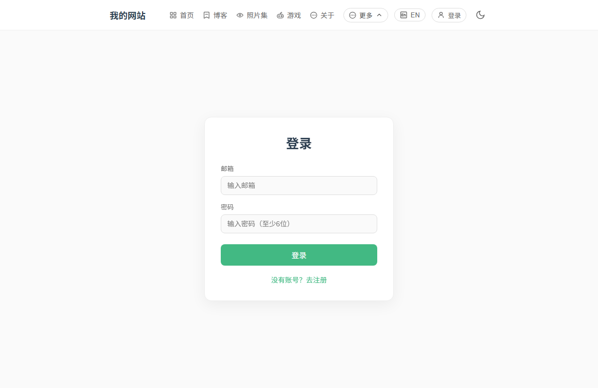
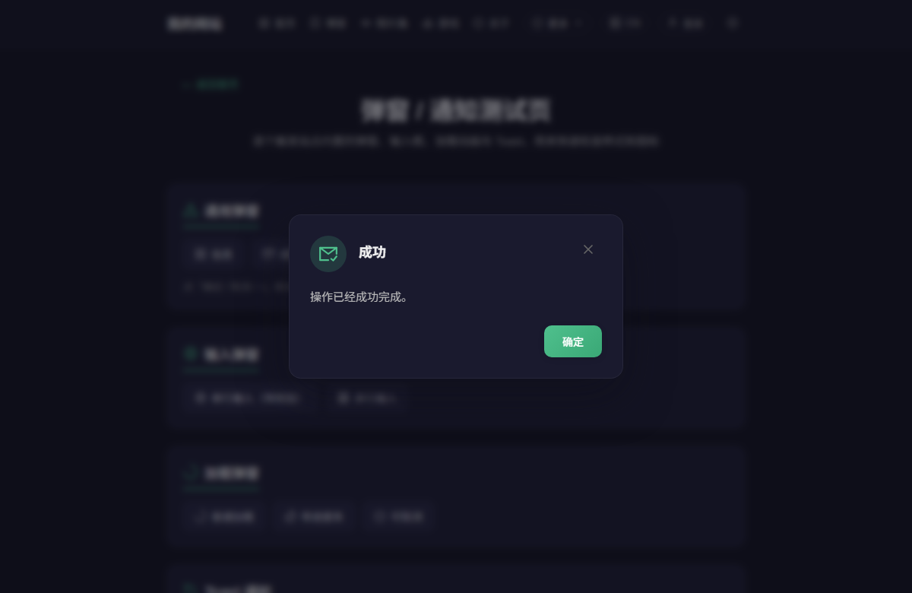
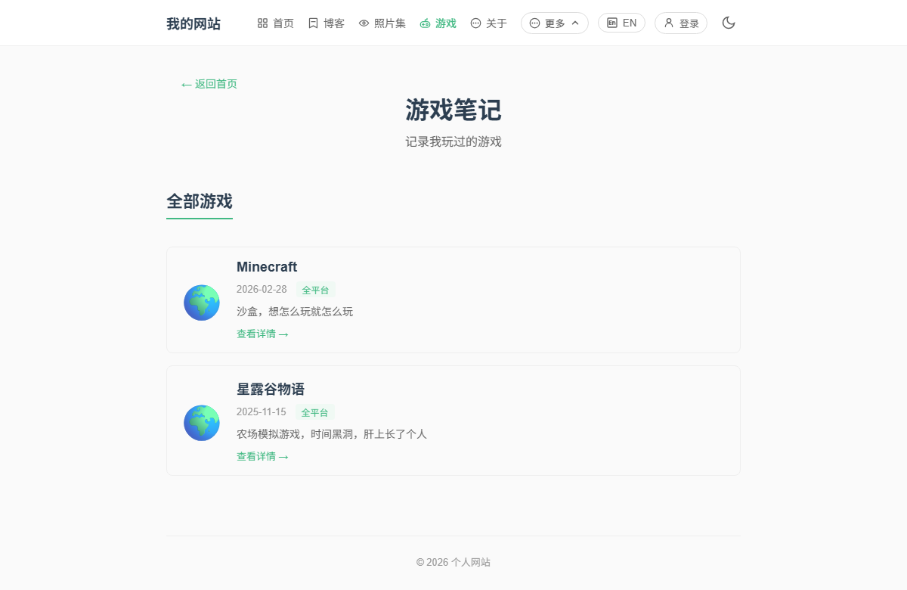
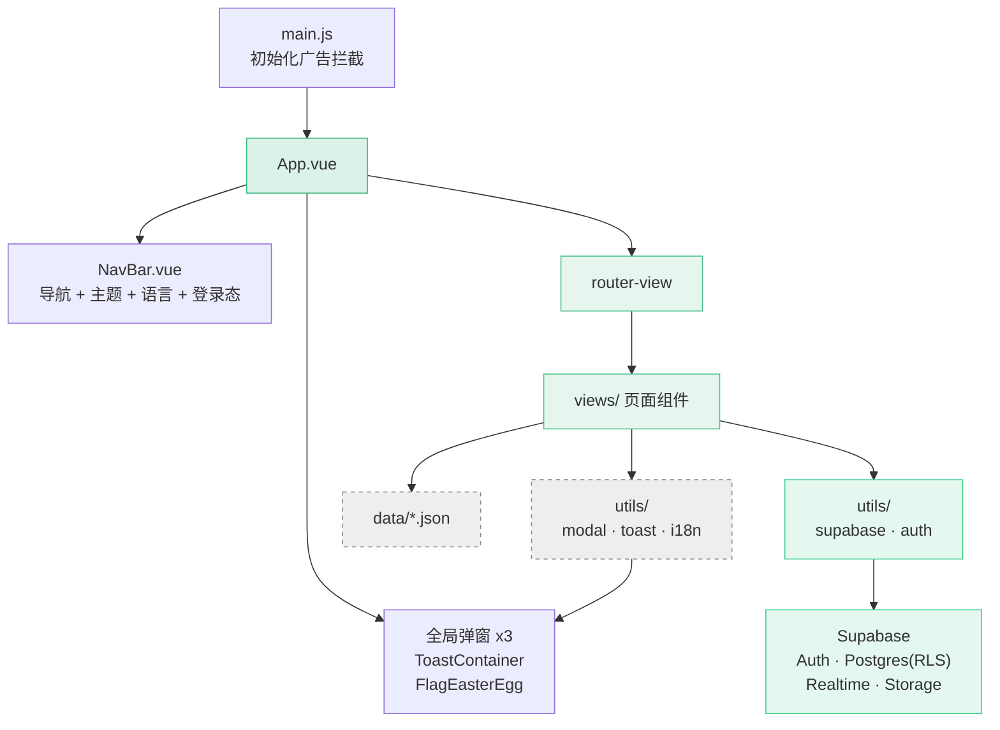
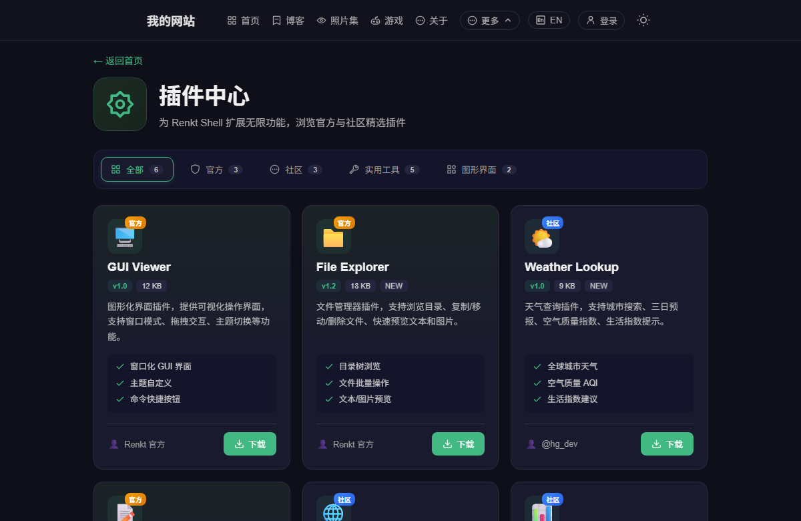
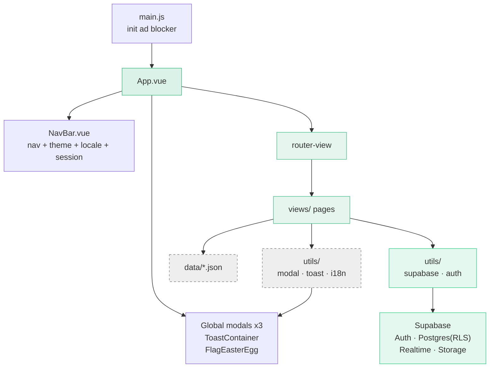

<p align="center">
  
</p>

<p align="center">
  
</p>

<h1 align="center">My Personal Website</h1>

<p align="center">
  <em>用 Vue 3 写的一个个人网站 —— 记录学习、生活与思考</em><br />
  <sub>A personal website built with Vue 3 — documenting learning, life, and thoughts</sub>
</p>

<p align="center">
  <a href="#zh">🇨🇳 中文</a> · <a href="#en">🇬🇧 English</a>
</p>

<p align="center">
  
  
  
  
  
  
  
</p>

<p align="center">
  
  
  
  
  
  
  
</p>

<p align="center">
  <a href="https://HGfds29.github.io/my-web"></a>
  <a href="http://qwe159259.3vkj.vip/"></a>
  <a href="https://github.com/HGfds29/my-web"></a>
</p>

---

## 中文 <span id="zh"></span>

> 个人网站 + 一个小型社区：博客、照片墙、游戏笔记由仓库里的 JSON 驱动；登录、实时聊天、好友与群组、讨论区走 Supabase。没有自建后端。

### 目录

- [预览](#预览)
- [技术栈](#技术栈)
- [功能特性](#功能特性)
- [页面与路由](#页面与路由)
- [项目结构](#项目结构)
- [架构与数据流](#架构与数据流)
- [快速开始](#快速开始)
- [部署](#部署)
- [本地专属文件](#本地专属文件)
- [开发约定](#开发约定)
- [常见问题](#常见问题)
- [项目数据](#项目数据)
- [许可证](#许可证)

### 预览

<p align="center">
  
</p>

| 首页 · 深色 | 博客列表 |
| :---: | :---: |
|  |  |

| 登录 | 弹窗 · 深色 |
| :---: | :---: |
|  |  |

| 游戏笔记 |
| :---: |
|  |

> [!NOTE]
> 截图由无头浏览器在构建产物上实拍（1200×780，浅色与深色各取一版），不是设计稿。聊天页需要登录、讨论区需要连上 Supabase 才有内容，故未收录。
> 界面改动后一条命令即可重拍：`node plugins/screenshots.mjs`（自动构建 → 起临时静态服务 → 无头浏览器逐页截图）。

### 技术栈

| 类别 | 用了什么 | 说明 |
| :--- | :--- | :--- |
| 框架 | Vue 3.5 · Composition API · `<script setup>` | 不引状态库，靠组件内状态 + 单例模块共享 |
| 构建 | Vite 6 | `base: '/my-web/'`，产物路径带前缀以适配 GitHub Pages |
| 路由 | vue-router 4 · Hash 模式 | 静态托管不需要服务端重写规则，带登录守卫 |
| 样式 | 原生 CSS + `html.dark` | 组件内 scoped；跨组件的深色规则集中在 `global.css` |
| 国际化 | 自研轻量 i18n | 中/英双语，支持 `t('a.b.c')` 与 `{n}` 插值 |
| 图标 | 59 个线性 SVG + `<AppIcon>` | 图标只当遮罩，颜色走 `currentColor` |
| 后端 | Supabase | Auth 登录、Postgres（全部表开 RLS）、Realtime 实时订阅、Storage 存聊天与帖子图片 |
| 内容数据 | 本地 JSON | `blog.json` / `games.json` / `photos.json`，改文件即改内容 |
| 交互组件 | 自研弹窗与 Toast | 命令式调用，不依赖任何 UI 库 |

### 功能特性

**🎨 界面与交互**

- ✨ 页面左右滑入 + Stagger 延迟动画（路由守卫控制方向与离场时机）
- 🌗 深色 / 浅色主题，跟随系统偏好，选择持久化到 `localStorage`
- 📱 响应式布局，移动端可用
- 🖼️ 弹窗进退场动画：入场回弹、退场加速内缩，遮罩比卡片多留 60ms

**💬 登录与聊天（Supabase）**

- 🔐 邮箱注册 / 登录，支持重发确认邮件，会话持久化；`/chat` 有路由守卫，未登录会带 `redirect` 参数跳到登录页
- ⚡ 公共聊天室：Realtime 订阅新消息，无需刷新
- 👥 好友申请与私聊（`friendships` / `friend_requests` / `dm_messages`）
- 🗂️ 群组与群消息（`groups` / `group_members` / `group_messages`）
- 🚫 封禁名单（`bans`）、聊天图片上传（Storage bucket）
- 🔒 9 张表全部启用 RLS 策略，权限在数据库层收敛

**🗣️ 讨论区（Supabase）**

- 📝 发帖 / 编辑 / 删除，支持封面图、标签，管理员可置顶
- 🖼️ 正文里可以插图，图片走 Storage（上传前校验类型与大小）
- 💬 评论、楼中楼回复、评论点赞
- 🔍 按标题或内容搜索，分页浏览
- 👀 浏览不需要登录，发帖与评论需要（未登录会提示「去登录」）
- 🔒 `posts` / `post_comments` / `post_comment_likes` 同样全部开 RLS

**📚 内容**

- 📝 博客：分页列表 + 详情页，支持图片
- 🎮 游戏笔记：列表 + 详情（封面、平台、正文）
- 📸 照片墙：宝丽来风格，**可拖拽排序**、**钉子固定**、**软木板模式**，位置与状态存 Cookie
  - 🖼️ 把图片丢进 `src/assets/photos/`，重启开发服务器就会自动出现在墙上
- 🚩 英雄纪念页：B 站视频嵌入，中英双语标题

**🧩 内置组件（无 UI 库）**

- 💬 命令式弹窗：`info` / `success` / `warning` / `error` / `confirm`，支持自定义按钮与遮罩行为
- ⌨️ 输入弹窗：必填、长度、正则校验，带字数计数器
- ⏳ 加载弹窗：可取消、可显示百分比进度
- 🔔 Toast 通知：队列管理、鼠标悬停**暂停计时**、7 种弹出位置
- 🎯 图标：`<AppIcon name="游戏手柄_game-handle" :size="18" />`，颜色自动跟随所在位置

**🌏 其他**

- 🌐 中/英全站切换，同步 `<html lang>`
- 🧭 导航栏「更多」下拉收起 功能演示 / 聊天室 / 讨论区；登录后右上角变成用户菜单（头像、用户名、管理员徽章、改密码、复制用户 ID、退出登录）
- 🥚 右下角藏了个彩蛋：鼠标移到右下角会出现一面旗帜，点击进入英雄纪念页
- 🛡️ 内置广告拦截（`MutationObserver` + 定时扫描），清理免费空间商注入的广告

### 页面与路由

| 页面 | 路由 | 说明 |
| :--- | :--- | :--- |
| 🏠 首页 | `#/home` | 欢迎页、最新文章、个人信息 |
| 📝 博客列表 | `#/blog` | 分页展示，带翻页动画 |
| 📄 博客详情 | `#/blog/:id` | 文章正文 |
| 👤 关于 | `#/about` | 个人信息、技能栈、联系方式 |
| 📸 照片集 | `#/photos` | 拖拽 / 钉住 / 软木板 |
| 🎮 游戏笔记 | `#/games` | 游戏列表（分页） |
| 🕹️ 游戏详情 | `#/games/:id` | 单个游戏的介绍 |
| 🧩 插件中心 | `#/plugins` | Renkt Shell 插件库与开发指南 |
| 🔐 登录 | `#/login` | 邮箱注册 / 登录 |
| 💬 聊天 | `#/chat` | **需登录**；公共聊天、好友私聊、群组 |
| 🗣️ 讨论区 | `#/discussion` | 发帖 / 评论 / 点赞 / 置顶 / 搜索；浏览免登录，发言需登录 |
| 🧪 弹窗测试 | `#/demo` | 逐个触发弹窗 / 输入框 / 加载 / Toast，检查动画与配色 |
| 🖥️ Renkt Shell | `#/renkt` | 产品页，**本地专属**，文件不存在时自动不注册该路由 |
| 🚩 英雄纪念 | `#/hero-memorial` | 隐藏导航栏，从彩蛋进入 |
| 🚫 404 | 任意未匹配路径 | 友好提示 + 返回首页 |

> [!NOTE]
> 根路径 `/` 会重定向到 `/home`。路由的 `meta.index` 决定页面切换时的滑动方向；`meta.requiresAuth` 的页面会先被登录守卫拦截。

### 项目结构

```text
.
├── index.html                 # HTML 入口（含 hash 兜底）
├── vite.config.js             # base: '/my-web/'
├── setup-chat.sql             # 聊天系统建表脚本（9 张表 + RLS + Realtime + Storage，幂等可重复运行）
├── setup-discussion.sql       # 讨论区建表脚本（posts / post_comments / post_comment_likes + RLS）
├── .env.example               # Supabase 配置模板（复制为 .env.local）
├── docs/screenshots/          # README 用的实拍截图
├── plugins/
│   ├── terminalPretty.js      # Vite 插件：把构建 / 开发 / 失败的终端输出画成方框
│   └── screenshots.mjs        # 构建 + 起服务 + 无头浏览器，一条命令重拍全部截图
├── src/
│   ├── main.js                # 入口：初始化广告拦截 → 挂载应用
│   ├── App.vue                # 根组件：导航栏 + 路由出口 + 全局弹窗 / Toast
│   ├── router/index.js        # 路由表 + 登录守卫 + 离场过渡守卫
│   ├── views/                 # 15 个页面组件
│   ├── components/            # 7 个组件（AppIcon、导航栏、3 个弹窗、Toast 容器、彩蛋旗帜）
│   ├── utils/
│   │   ├── modal.js           # 命令式弹窗控制
│   │   ├── toast.js           # Toast 队列控制
│   │   ├── i18n.js            # 双语词条与 t() 实现
│   │   ├── adBlocker.js       # 广告拦截
│   │   ├── supabase.js        # Supabase 客户端 + 数据访问
│   │   └── auth.js            # 会话、注册、登录、登出、资料
│   ├── data/                  # blog.json / games.json / photos.json
│   └── assets/
│       ├── css/global.css     # 全局样式 + 所有深色模式规则
│       ├── logo.png
│       └── photos/            # 照片墙素材（目录需自建，放入图片即自动展示）
├── public/
│   ├── favicon.ico
│   ├── svg/                   # 59 个线性图标（AppIcon 的素材源）
│   ├── desk-pet/              # 桌宠素材（约 15 MB，未入库）
│   └── Renkt Shell/           # Renkt Shell 发行包（约 63 MB，未入库）
└── dist/                      # 构建产物（主仓库不跟踪，内有独立 git 仓库用于发布）
```

### 架构与数据流



### 快速开始

需要 Node.js 18+（推荐 20 或更高）。

```bash
npm install
cp .env.example .env.local     # 然后填入两个 Supabase 变量
npm run dev                    # 启动开发服务器
npm run build                  # 构建生产版本到 dist/（不生成 sourcemap，约 631 kB）
npm run build -- --sourcemap   # 需要调试时：额外生成 sourcemap（约 2.9 MB）
npm run build:map              # 同上，等价的简写
npm run preview                # 本地预览构建结果
```

> [!IMPORTANT]
> **登录、聊天、讨论区需要先配置 Supabase**，否则这三块功能不可用（博客、照片墙、游戏笔记等 JSON 驱动的部分不受影响，可以正常运行）。

配置三步：

1. 在 [Supabase](https://supabase.com/) 建一个项目
2. 打开 SQL Editor，依次整段执行根目录的两个脚本（都是幂等的，重复跑也没事）：
   - `setup-chat.sql` —— 聊天室 9 张表 + RLS + Realtime + 图片 bucket
   - `setup-discussion.sql` —— 讨论区 `posts` / `post_comments` / `post_comment_likes` + RLS
3. 把 Project URL 和 publishable key 填进 `.env.local`：

```dotenv
VITE_SUPABASE_URL=https://xxxxxxxx.supabase.co
VITE_SUPABASE_PUBLISHABLE_KEY=sb_publishable_xxxxxxxx
```

> [!TIP]
> 日常改内容基本不用碰组件代码，只要动下面这几个文件。

- 加文章 → 编辑 `src/data/blog.json`
- 加游戏 → 编辑 `src/data/games.json`
- 加照片 → 把图片放进 `src/assets/photos/`
- 加界面文案 → 编辑 `src/utils/i18n.js`

### 部署

线上有两份：GitHub Pages（`HGfds29.github.io/my-web`）和国内镜像（`qwe159259.3vkj.vip`）。

> [!WARNING]
> **`VITE_*` 变量会在构建时被内联进产物。** 所以构建机器上也必须有 `.env.local`（或在 CI 里注入同名环境变量）；不是在服务器上运行时再读。产物里能看到 publishable key 属正常现象 —— 它只是公开标识，真正的权限由数据库的 RLS 策略控制。

| 方式 | 做法 |
| :--- | :--- |
| 发布到 `gh-pages` 分支 | `npm run build` 后把 `dist/` 内容推到 `gh-pages` 分支，并在仓库设置里把 Pages 源指向该分支 |
| GitHub Actions | 在 workflow 里注入 `VITE_*` secrets，`npm ci && npm run build`，再把 `dist/` 作为 Pages 产物发布 |
| 手动上传 | `npm run build` 后把 `dist/` 里的文件上传到虚拟主机 / 国内镜像 |

`vite.config.js` 里的 `base` 必须与部署路径一致：部署在子路径（如 `/my-web/`）就保持 `'/my-web/'`；部署在域名根目录要改成 `'/'`。

另外，`.gitignore` 现在**不再忽略** `dist/`；仓库里的 `dist/` 目前是一个嵌套的独立 git 仓库（`dist/.git`），用于单独发布构建产物，主仓库不会跟踪它里面的文件。

### 本地专属文件

> [!NOTE]
> 以下内容**只在本地存在，不在仓库里**（都被 `.gitignore` 排除了），自己开发时不受影响，但别人 clone 下来是没有的。

<details>
<summary><b>点击展开：哪些文件没有入库，以及为什么</b></summary>

<br />

| 路径 | 大小 | 说明 |
| :--- | :--- | :--- |
| `.env.local` | — | Supabase 的 URL 与 key，属于本地密钥，只提交 `.env.example` 模板 |
| `src/views/RenktShell.vue` | — | Renkt Shell 产品页源码，仅本地保留 |
| `public/Renkt Shell/` | ≈ 63 MB | 发行包，含 `Renkt-v1.2.5.zip` |
| `public/desk-pet/` | ≈ 15 MB | 桌宠页面与素材 |
| `node_modules/` | — | 依赖，用 `npm install` 还原 |

关于 `RenktShell.vue`：路由**没有**用静态 `import` 引它，而是用 `import.meta.glob('../views/Renkt*.vue')` 动态解析。文件不存在时 `/renkt` 路由就不会注册，所以**别人 clone 后依然能正常构建**。相应地，插件中心里指向该页面的按钮在没有此文件时会跳到 404 页 —— 这是预期行为，不是 bug。

需要注意的一个副作用：`RenktShell.vue` 存在时它会作为独立懒加载分块打包（约 12 KB JS + 7 KB CSS），首次进入该页时才下载。

</details>

### 开发约定

**深色模式统一写在 `src/assets/css/global.css`。** 用 `html.dark .选择器 { ... !important }` 的形式，不要写在组件的 scoped 样式里：

```css
/* 正确：写在 global.css */
html.dark .game-item { border-color: #2d2d44 !important; }
```

> [!IMPORTANT]
> 原因：Vue 3.5 的 scoped 样式编译器会把 `:global(.dark) .game-item` 编译成 `.dark { ... }` —— **`:global()` 之后的后代选择器会被整段丢弃**，规则只命中挂在 `<html>` 上的类名，等于废代码。这个坑在本项目历史上踩过一次，导致整页深色模式失效。

**两层 `<Transition>` 不要绑在同一个 `v-if` 上。** 入场时父元素先插入、子元素再挂载，所以内层动画能播；但退场时父元素是整体移除的，子元素「跟着走」，**内层 Transition 的退场钩子根本不会触发**。弹窗踩过这个坑，表现是「遮罩在淡出、卡片硬消失」：

```css
/* 正确：卡片的退场挂在遮罩的过渡类上 */
.modal-overlay.modal-overlay-leave-active .modal-content {
  transition: opacity 0.26s ease-in, transform 0.3s cubic-bezier(0.4, 0, 0.6, 1);
}
.modal-overlay.modal-overlay-leave-to .modal-content {
  opacity: 0;
  transform: scale(0.92) translateY(-14px);
}
```

**图标统一用 `<AppIcon>`，不要用 `` 直接引 SVG。** `<AppIcon>` 把 SVG 当遮罩、颜色交给 `currentColor`，所以图标会自动适配深色模式、悬停态和错误/警告的状态色；用 `` 的话颜色是写死在文件里的。

**其他约定**

- 离场动画时长 `LEAVE_DURATION = 450`（在 `router/index.js`）必须与页面 CSS 动画时长一致，改一处要改另一处
- 新增页面三步：在 `views/` 建组件 → 在 `router/index.js` 注册 → 给它一个 `meta.index`（决定滑动方向）；需要登录再加 `meta.requiresAuth`
- 深色配色参考值：背景 `#1a1a2e`、边框 `#2d2d44`、主色 `#42b983`、正文 `#e0e0e0`、次要文字 `#aaa`
- 语义色：成功 `#4FC08D`、错误 `#e0524b`、警告 `#d9932b`

### 常见问题

<details>
<summary><b>登录或聊天不能用了？</b></summary>

<br />

按顺序检查三处：`.env.local` 是否存在且两个变量都有值 → `setup-chat.sql` 是否在同一个 Supabase 项目里执行过 → 浏览器控制台是否有 RLS 或 401 报错。改完 `.env.local` 必须重启 `npm run dev`（Vite 只在启动时读取环境变量）。

</details>

<details>
<summary><b>构建后聊天请求全部失败？</b></summary>

<br />

`VITE_*` 是**构建时**内联的，不是运行时读取。检查构建机器上是否有 `.env.local`，或 CI 是否注入了同名变量。

</details>

<details>
<summary><b>照片墙不显示我放进去的图片？</b></summary>

<br />

`import.meta.glob` 在开发服务器启动时扫描 `src/assets/photos/`，新加图片后**重启 `npm run dev`** 即可。目录不存在就自己新建一个，图片会按文件名顺序排列。

</details>

<details>
<summary><b>构建后图片或下载链接 404？</b></summary>

<br />

检查 `vite.config.js` 的 `base` 是否与真实部署路径一致；静态资源要用 `import.meta.env.BASE_URL` 拼接，不要写死以 `/` 开头的绝对路径。

</details>

<details>
<summary><b>照片墙的位置错乱了？</b></summary>

<br />

位置存在 Cookie 里（键名 `photo_album_pos`），照片多到一定程度可能超过 4 KB 的 Cookie 上限导致保存失败。页面上有「重置位置」按钮可以清空。

</details>

<details>
<summary><b>插件中心的按钮点了跳到 404？</b></summary>

<br />

见上文「本地专属文件」：`RenktShell.vue` 不在仓库里时 `/renkt` 路由不会注册，属预期行为。

</details>

<details>
<summary><b>为什么 <code>npm run build -map</code> 打不开 sourcemap？</b></summary>

<br />

因为参数到不了 Vite：

1. npm 把单横杠参数按短选项拆分，`-map` 变成 `-m -a -p` 并被 npm 自己消费（实测脚本只收到 `build`）；
2. 就算用 `npm run build -- -map` 硬传到 Vite，Vite 的 CLI（cac）也会因为不认识该参数直接抛 `Unknown option '-a'`。

所以要用 Vite 原生的 `--sourcemap`：

```bash
npm run build -- --sourcemap   # 或等价的 npm run build:map
```

默认构建不生成 sourcemap（约 631 kB），开启后约 2.9 MB —— 单是 `.map` 就 2.28 MB。

</details>

<details>
<summary><b>讨论区一直停在「加载中…」或提示加载失败？</b></summary>

<br />

说明前端没拿到数据，按这两种情况排查：

- **提示加载失败**：多半是 `setup-discussion.sql` 没在**同一个** Supabase 项目里执行过，`posts` 等表不存在；
- **一直停在「加载中…」**：请求发出去了但没回来 —— 检查 `.env.local` 里的 URL 是否指向真实项目、该域名是否被网络拦截。

两种都能在浏览器控制台看到具体报错，定位最快。

</details>

### 项目数据

<p align="center">
  
</p>

<p align="center">
  <a href="https://star-history.com/#HGfds29/my-web&Date">
    
  </a>
</p>

<details>
<summary><b>展开：仓库卡片、语言占比、提交活跃度与贡献者趋势</b></summary>

<br />

<p align="center">
  <picture>
    <source media="(prefers-color-scheme: dark)" srcset="https://github-readme-stats.vercel.app/api/pin/?username=HGfds29&repo=my-web&bg_color=0f0f1a&title_color=42b983&text_color=e0e0e0&icon_color=42b983&border_color=2d2d44" />
    
  </picture>
  <picture>
    <source media="(prefers-color-scheme: dark)" srcset="https://github-readme-stats.vercel.app/api/top-langs/?username=HGfds29&layout=compact&langs_count=6&bg_color=0f0f1a&title_color=42b983&text_color=e0e0e0&border_color=2d2d44" />
    
  </picture>
</p>

<p align="center">
  <picture>
    <source media="(prefers-color-scheme: dark)" srcset="https://github-readme-activity-graph.vercel.app/graph?username=HGfds29&bg_color=0f0f1a&color=42b983&line=42b983&point=e0e0e0&hide_border=true&days=90" />
    
  </picture>
</p>

<p align="center">
  
</p>

</details>

### 许可证

MIT © 2026 [HGfds29](https://github.com/HGfds29)

<p align="right"><a href="#en">🇬🇧 Read in English</a> · <a href="#zh">↑ 回到顶部</a></p>

---

## English <span id="en"></span>

> A personal site plus a small community: blog, photo wall and game notes are driven by JSON in the repo; sign-in, realtime chat, friends and groups, and discussions run on Supabase. No self-hosted backend.

### Table of Contents

- [Preview](#preview)
- [Tech Stack](#tech-stack)
- [Features](#features)
- [Pages and Routes](#pages-and-routes)
- [Project Structure](#project-structure)
- [Architecture](#architecture)
- [Quick Start](#quick-start)
- [Deployment](#deployment)
- [Local-only Files](#local-only-files)
- [Development Conventions](#development-conventions)
- [FAQ](#faq)
- [Project Metrics](#project-metrics)
- [License](#license)

### Preview

<p align="center">
  
</p>

| Home · dark | Blog list |
| :---: | :---: |
|  |  |

| Game notes | Plugin hub · dark |
| :---: | :---: |
|  |  |

| Login | Dialog · dark |
| :---: | :---: |
|  |  |

> [!NOTE]
> Screenshots are real captures of the production build (1200×780, one per theme), not mockups. The chat page requires sign-in and the discussion page needs a live Supabase to show content, so neither is included.
> After UI changes, regenerate them all with one command: `node plugins/screenshots.mjs` (builds → serves → captures via a headless browser).

### Tech Stack

| Category | What | Notes |
| :--- | :--- | :--- |
| Framework | Vue 3.5 · Composition API · `<script setup>` | No state library — component state plus singleton modules |
| Build | Vite 6 | `base: '/my-web/'` so asset URLs work under a sub-path |
| Router | vue-router 4 · Hash mode | Static hosting needs no rewrites; includes an auth guard |
| Styling | Plain CSS + `html.dark` | Scoped per component; cross-component dark rules live in `global.css` |
| i18n | Hand-rolled, lightweight | Chinese / English, `t('a.b.c')` plus `{n}` interpolation |
| Icons | 59 line SVGs + `<AppIcon>` | SVGs are used only as a mask; colour comes from `currentColor` |
| Backend | Supabase | Auth, Postgres with RLS on every table, Realtime subscriptions, Storage for chat and post images |
| Content data | Local JSON | `blog.json` / `games.json` / `photos.json` — edit the file, change the site |
| UI widgets | Hand-rolled modals & toasts | Imperative API, zero UI-library dependencies |

### Features

**🎨 Interface**

- ✨ Direction-aware slide transitions with staggered entrance animations
- 🌗 Dark / light theme that follows the system preference and persists to `localStorage`
- 📱 Responsive and mobile friendly
- 🖼️ Dialog motion: springy entrance, accelerating shrink on exit, overlay lingers 60 ms longer

**💬 Auth and chat (Supabase)**

- 🔐 Email sign-up / sign-in with resendable confirmation mail and a persisted session; `/chat` is guarded and redirects to `/login` with a `redirect` query
- ⚡ Public room: new messages arrive over Realtime without a refresh
- 👥 Friend requests and direct messages (`friendships` / `friend_requests` / `dm_messages`)
- 🗂️ Groups and group messages (`groups` / `group_members` / `group_messages`)
- 🚫 Ban list (`bans`) and chat image uploads (Storage bucket)
- 🔒 Nine tables, all with row level security policies — authorisation lives in the database

**🗣️ Discussions (Supabase)**

- 📝 Create / edit / delete posts, with cover image, tags, and admin-only pinning
- 🖼️ Inline images inside a post, uploaded to Storage (type and size validated first)
- 💬 Comments, threaded replies, and comment likes
- 🔍 Search by title or body, paginated browsing
- 👀 Reading needs no account; posting and commenting do (guests are prompted to sign in)
- 🔒 `posts` / `post_comments` / `post_comment_likes` carry RLS policies too

**📚 Content**

- 📝 Blog: paginated list + detail pages with images
- 🎮 Game notes: list + detail (cover, platform, article body)
- 📸 Photo wall: Polaroid style with **drag to rearrange**, **pin in place**, **corkboard mode**; positions and state stored in a cookie
  - 🖼️ Drop images into `src/assets/photos/` and restart the dev server — they appear automatically
- 🚩 Memorial page with an embedded Bilibili video and bilingual headings

**🧩 Built-in widgets (no UI library)**

- 💬 Imperative dialogs: `info` / `success` / `warning` / `error` / `confirm`, with customisable buttons and overlay behaviour
- ⌨️ Prompt dialog with required / length / regex validation and a character counter
- ⏳ Loading dialog that can be cancelled and can show percentage progress
- 🔔 Toast notifications: queue management, **timer pause on hover**, 7 positions
- 🎯 Icons: `<AppIcon name="游戏手柄_game-handle" :size="18" />` — colour follows its surroundings

**🌏 Extras**

- 🌐 Full ZH / EN switching that also syncs `<html lang>`
- 🧭 A "More" dropdown in the nav groups Playground / Chat / Discussions; once signed in the corner becomes a user menu (avatar, username, admin badge, change password, copy user ID, sign out)
- 🥚 A hidden easter egg in the bottom-right corner: hover to reveal a flag, click to enter the memorial page
- 🛡️ Built-in ad blocker (`MutationObserver` + periodic scanning) that removes ads injected by free hosting

### Pages and Routes

| Page | Route | Description |
| :--- | :--- | :--- |
| 🏠 Home | `#/home` | Welcome, latest posts, personal info |
| 📝 Blog list | `#/blog` | Paginated with page-turn animation |
| 📄 Blog detail | `#/blog/:id` | Full article |
| 👤 About | `#/about` | Bio, skills, contact |
| 📸 Photos | `#/photos` | Drag / pin / corkboard |
| 🎮 Game notes | `#/games` | Paginated game list |
| 🕹️ Game detail | `#/games/:id` | Single game write-up |
| 🧩 Plugin hub | `#/plugins` | Renkt Shell plugin library and dev guide |
| 🔐 Login | `#/login` | Email sign-up / sign-in |
| 💬 Chat | `#/chat` | **Requires sign-in**; public room, DMs, groups |
| 🗣️ Discussions | `#/discussion` | Posts / comments / likes / pinning / search; read freely, post after signing in |
| 🧪 Playground | `#/demo` | Trigger every dialog / prompt / loader / toast to check motion and colour |
| 🖥️ Renkt Shell | `#/renkt` | Product page, **local-only**; the route is skipped when the file is absent |
| 🚩 Hero memorial | `#/hero-memorial` | Hides the nav bar; reached via the easter egg |
| 🚫 404 | any unmatched path | Friendly message + back home |

> [!NOTE]
> `/` redirects to `/home`. A route's `meta.index` decides the slide direction; routes with `meta.requiresAuth` are intercepted by the auth guard first.

### Project Structure

```text
.
├── index.html                 # HTML shell (with a hash fallback)
├── vite.config.js             # base: '/my-web/'
├── setup-chat.sql             # Chat schema (9 tables + RLS + Realtime + Storage, idempotent)
├── setup-discussion.sql       # Discussion schema (posts / post_comments / post_comment_likes + RLS)
├── .env.example               # Supabase config template (copy to .env.local)
├── docs/screenshots/          # Screenshots used by this README
├── plugins/
│   ├── terminalPretty.js      # Vite plugin: boxed terminal output for build / dev / failure
│   └── screenshots.mjs        # Build + serve + headless browser, regenerates every screenshot
├── src/
│   ├── main.js                # Entry: init ad blocker → mount app
│   ├── App.vue                # Root: nav bar + router outlet + global modals / toasts
│   ├── router/index.js        # Route table + auth guard + leave-transition guard
│   ├── views/                 # 15 page components
│   ├── components/            # 7 components (AppIcon, nav bar, 3 modals, toast container, flag egg)
│   ├── utils/
│   │   ├── modal.js           # Imperative dialog control
│   │   ├── toast.js           # Toast queue control
│   │   ├── i18n.js            # Bilingual dictionary and t()
│   │   ├── adBlocker.js       # Ad blocker
│   │   ├── supabase.js        # Supabase client + data access
│   │   └── auth.js            # Session, sign-up, sign-in, sign-out, profile
│   ├── data/                  # blog.json / games.json / photos.json
│   └── assets/
│       ├── css/global.css     # Global styles + every dark-mode rule
│       ├── logo.png
│       └── photos/            # Photo wall assets (create the folder, then drop files in)
├── public/
│   ├── favicon.ico
│   ├── svg/                   # 59 line icons (the source assets for AppIcon)
│   ├── desk-pet/              # Desk-pet assets (~15 MB, not committed)
│   └── Renkt Shell/           # Renkt Shell release (~63 MB, not committed)
└── dist/                      # Build output (not tracked by the main repo; holds its own git repo for publishing)
```

### Architecture



### Quick Start

Requires Node.js 18+ (20 or newer recommended).

```bash
npm install
cp .env.example .env.local     # then fill in the two Supabase values
npm run dev                    # start the dev server
npm run build                  # build into dist/ (no sourcemap, ~631 kB)
npm run build -- --sourcemap   # debugging: also emit sourcemaps (~2.9 MB)
npm run build:map              # same thing, shorter alias
npm run preview                # preview the production build locally
```

> [!IMPORTANT]
> **Auth, chat and discussions need Supabase configured**, otherwise those three features are unavailable (everything JSON-driven — blog, photo wall, game notes — works without it).

Three steps:

1. Create a project on [Supabase](https://supabase.com/)
2. Open the SQL editor and run both scripts from the repo root, one after the other (both are idempotent, safe to re-run):
   - `setup-chat.sql` — 9 chat tables + RLS + Realtime + the image bucket
   - `setup-discussion.sql` — `posts` / `post_comments` / `post_comment_likes` + RLS
3. Put the project URL and publishable key into `.env.local`:

```dotenv
VITE_SUPABASE_URL=https://xxxxxxxx.supabase.co
VITE_SUPABASE_PUBLISHABLE_KEY=sb_publishable_xxxxxxxx
```

> [!TIP]
> Day-to-day content changes need no component edits — just these files.

- New post → edit `src/data/blog.json`
- New game → edit `src/data/games.json`
- New photo → drop the image into `src/assets/photos/`
- New UI string → edit `src/utils/i18n.js`

### Deployment

There are two live copies: GitHub Pages (`HGfds29.github.io/my-web`) and a China mirror (`qwe159259.3vkj.vip`).

> [!WARNING]
> **`VITE_*` variables are inlined at build time.** The build machine therefore needs `.env.local` too (or the same variables injected as CI secrets) — they are not read at runtime by the server. Seeing the publishable key inside the bundle is expected: it is only a public identifier, and authorisation is enforced by the database's RLS policies.

| Approach | How |
| :--- | :--- |
| Publish to a `gh-pages` branch | `npm run build`, push the contents of `dist/` to `gh-pages`, point Pages at that branch |
| GitHub Actions | Inject `VITE_*` secrets in the workflow, `npm ci && npm run build`, then publish `dist/` as the Pages artifact |
| Manual upload | `npm run build`, then upload the contents of `dist/` to your host / mirror |

The `base` value in `vite.config.js` must match the deploy path: keep `'/my-web/'` for a sub-path, change it to `'/'` for a domain root.

Note that `.gitignore` currently does **not** ignore `dist/`; the `dist/` in this repo is its own nested git repository (`dist/.git`) used to publish the build output separately, and the main repo does not track its contents.

### Local-only Files

> [!NOTE]
> The following exist **only on the author's machine** and are excluded by `.gitignore`, so a fresh clone will not contain them.

<details>
<summary><b>Expand: what is not committed, and why</b></summary>

<br />

| Path | Size | Notes |
| :--- | :--- | :--- |
| `.env.local` | — | Supabase URL and key — local secrets; only the `.env.example` template is committed |
| `src/views/RenktShell.vue` | — | Renkt Shell product page source, kept local |
| `public/Renkt Shell/` | ≈ 63 MB | Release bundle including `Renkt-v1.2.5.zip` |
| `public/desk-pet/` | ≈ 15 MB | Desk-pet page and assets |
| `node_modules/` | — | Dependencies, restored by `npm install` |

About `RenktShell.vue`: the router does **not** statically import it. It resolves the view with `import.meta.glob('../views/Renkt*.vue')`, so when the file is missing the `/renkt` route is simply not registered and **a fresh clone still builds successfully**. Consequently, the button in the plugin hub that points at that page lands on the 404 page when the file is absent — expected, not a bug.

One side effect worth knowing: when the file *is* present it is bundled as its own lazy chunk (about 12 KB JS + 7 KB CSS), downloaded only on first visit to that page.

</details>

### Development Conventions

**Dark-mode rules belong in `src/assets/css/global.css`**, written as `html.dark .selector { ... !important }`. Do not put them in a component's scoped styles:

```css
/* Correct: in global.css */
html.dark .game-item { border-color: #2d2d44 !important; }
```

> [!IMPORTANT]
> Why: the Vue 3.5 scoped-style compiler turns `:global(.dark) .game-item` into `.dark { ... }` — **everything after `:global()` is dropped**, so the rule only matches the class on `<html>` and does nothing. This project hit that trap once, which silently broke an entire page's dark mode.

**Never bind two nested `<Transition>`s to the same `v-if`.** On enter the parent element is inserted first and the child mounts inside it, so the inner animation plays; on leave the parent is removed as a whole, the child goes with it, and **the inner Transition's leave hook never fires**. The dialogs hit exactly this — the overlay faded out while the card vanished instantly:

```css
/* Correct: drive the card's exit from the overlay's transition classes */
.modal-overlay.modal-overlay-leave-active .modal-content {
  transition: opacity 0.26s ease-in, transform 0.3s cubic-bezier(0.4, 0, 0.6, 1);
}
.modal-overlay.modal-overlay-leave-to .modal-content {
  opacity: 0;
  transform: scale(0.92) translateY(-14px);
}
```

**Always use `<AppIcon>` instead of an `` pointing at an SVG.** `<AppIcon>` treats the SVG as a mask and takes the colour from `currentColor`, so icons adapt to dark mode, hover states and error/warning state colours automatically; with `` the colour is baked into the file.

**Other conventions**

- `LEAVE_DURATION = 450` in `router/index.js` must match the page CSS animation duration — change both together
- Adding a page takes three steps: create the component in `views/`, register it in `router/index.js`, give it a `meta.index` (which drives the slide direction); add `meta.requiresAuth` if it needs a session
- Dark palette reference: background `#1a1a2e`, border `#2d2d44`, accent `#42b983`, text `#e0e0e0`, muted `#aaa`
- Semantic colours: success `#4FC08D`, error `#e0524b`, warning `#d9932b`

### FAQ

<details>
<summary><b>Sign-in or chat stopped working</b></summary>

<br />

Check three things in order: does `.env.local` exist with both variables set → has `setup-chat.sql` been run against the same Supabase project → is the browser console showing RLS or 401 errors. After editing `.env.local` you must restart `npm run dev` (Vite only reads env vars at startup).

</details>

<details>
<summary><b>Every chat request fails after building</b></summary>

<br />

`VITE_*` variables are inlined **at build time**, not read at runtime. Check that the build machine has `.env.local`, or that CI injects the same variables.

</details>

<details>
<summary><b>My images do not show up on the photo wall</b></summary>

<br />

`import.meta.glob` scans `src/assets/photos/` when the dev server starts, so **restart `npm run dev`** after adding images. Create the folder first if it does not exist. Files are ordered by filename.

</details>

<details>
<summary><b>Images or download links 404 after building</b></summary>

<br />

Check that `base` in `vite.config.js` matches the real deploy path, and build asset URLs from `import.meta.env.BASE_URL` instead of hard-coding a leading `/`.

</details>

<details>
<summary><b>The photo wall layout got scrambled</b></summary>

<br />

Positions are stored in a cookie (`photo_album_pos`). With many photos the payload can exceed the 4 KB cookie limit and silently fail to save. The page has a "reset positions" button to clear it.

</details>

<details>
<summary><b>A button in the plugin hub leads to a 404</b></summary>

<br />

See "Local-only files" above: without `RenktShell.vue` the `/renkt` route is not registered. Expected behaviour.

</details>

<details>
<summary><b>Why doesn't <code>npm run build -map</code> enable sourcemaps?</b></summary>

<br />

Because the flag never reaches Vite:

1. npm parses single-dash arguments as clusters of short options, so `-map` becomes `-m -a -p` and is consumed by npm itself (the script only receives `build`);
2. even forcing it through with `npm run build -- -map`, Vite's CLI (cac) rejects the unknown option with `Unknown option '-a'`.

Use Vite's native flag instead:

```bash
npm run build -- --sourcemap   # or the equivalent npm run build:map
```

A default build emits no sourcemaps (~631 kB); with them it is ~2.9 MB, of which the `.map` file alone is 2.28 MB.

</details>

<details>
<summary><b>The discussion page is stuck on "loading" or reports a load failure</b></summary>

<br />

The front end never got its data. Two cases:

- **A load failure is shown**: `setup-discussion.sql` almost certainly has not been run against the **same** Supabase project, so tables such as `posts` do not exist;
- **It sits on "loading" forever**: the request left but never came back — check that the URL in `.env.local` points at the real project, and that the domain is not blocked by the network.

Either way the browser console shows the actual error, which is the fastest way to pin it down.

</details>

### Project Metrics

<p align="center">
  
</p>

<p align="center">
  <a href="https://star-history.com/#HGfds29/my-web&Date">
    
  </a>
</p>

<details>
<summary><b>Expand: repository card, language split, commit activity, and contributor trends</b></summary>

<br />

<p align="center">
  <picture>
    <source media="(prefers-color-scheme: dark)" srcset="https://github-readme-stats.vercel.app/api/pin/?username=HGfds29&repo=my-web&bg_color=0f0f1a&title_color=42b983&text_color=e0e0e0&icon_color=42b983&border_color=2d2d44" />
    
  </picture>
  <picture>
    <source media="(prefers-color-scheme: dark)" srcset="https://github-readme-stats.vercel.app/api/top-langs/?username=HGfds29&layout=compact&langs_count=6&bg_color=0f0f1a&title_color=42b983&text_color=e0e0e0&border_color=2d2d44" />
    
  </picture>
</p>

<p align="center">
  <picture>
    <source media="(prefers-color-scheme: dark)" srcset="https://github-readme-activity-graph.vercel.app/graph?username=HGfds29&bg_color=0f0f1a&color=42b983&line=42b983&point=e0e0e0&hide_border=true&days=90" />
    
  </picture>
</p>

<p align="center">
  
</p>

</details>

### License

MIT © 2026 [HGfds29](https://github.com/HGfds29)

<p align="right"><a href="#zh">🇨🇳 阅读中文</a> · <a href="#en">↑ Back to top</a></p>
