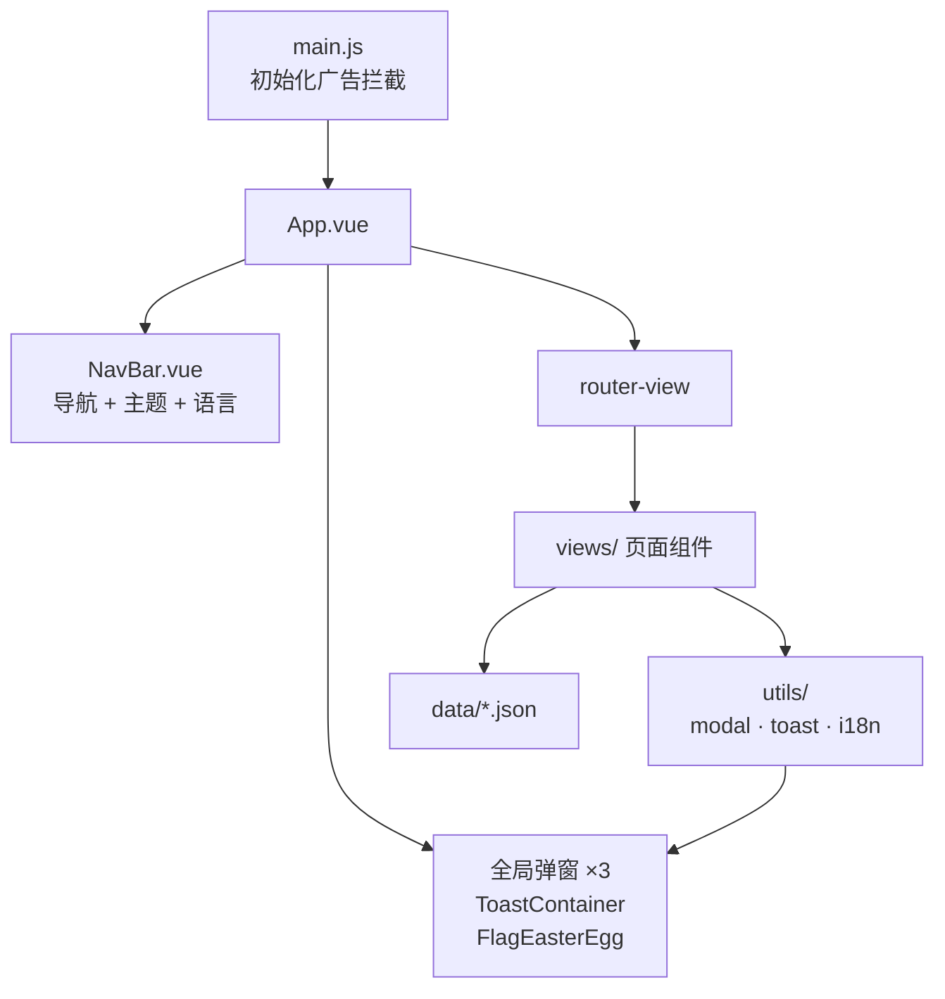
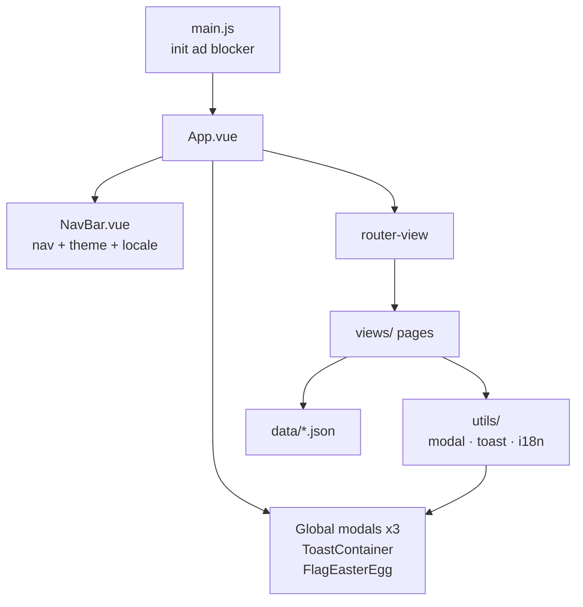

<p align="center">
  
</p>

<h1 align="center">My Personal Website</h1>

<p align="center">
  <em>用 Vue 3 写的一个个人网站 —— 记录学习、生活与思考</em><br />
  <sub>A personal website built with Vue 3 — documenting learning, life, and thoughts</sub>
</p>

<p align="center">
  
  
  
  
  
  
  
</p>

<p align="center">
  
  
  
  
  
  
  
</p>

<p align="center">
  <a href="https://HGfds29.github.io/my-web"><b>🔗 在线预览</b></a> ·
  <a href="http://qwe159259.3vkj.vip/"><b>🔗 国内线路</b></a>
</p>

<p align="center">
  <a href="#zh">🇨🇳 中文</a> · <a href="#en">🇬🇧 English</a>
</p>

---

## 中文 <span id="zh"></span>

> 一个纯前端的个人网站：博客、照片墙、游戏笔记，外加几个自娱自乐的小东西。没有后端，所有内容都是仓库里的 JSON 和文件。

### 目录

- [技术栈](#技术栈)
- [功能特性](#功能特性)
- [页面与路由](#页面与路由)
- [项目结构](#项目结构)
- [架构与数据流](#架构与数据流)
- [快速开始](#快速开始)
- [部署](#部署)
- [本地专属文件](#本地专属文件)
- [开发约定](#开发约定)
- [常见问题](#常见问题)
- [项目数据](#项目数据)
- [许可证](#许可证)

### 技术栈

| 类别 | 用了什么 | 说明 |
| :--- | :--- | :--- |
| 框架 | Vue 3.5 · Composition API · `<script setup>` | 不引状态库，靠组件内状态 + 单例模块共享 |
| 构建 | Vite 6 | `base: '/my-web/'`，产物路径带前缀以适配 GitHub Pages |
| 路由 | vue-router 4 · Hash 模式 | 静态托管不需要服务端重写规则 |
| 样式 | 原生 CSS + `html.dark` | 组件内 scoped；跨组件的深色规则集中在 `global.css` |
| 国际化 | 自研轻量 i18n | 中/英双语，支持 `t('a.b.c')` 与 `{n}` 插值 |
| 数据 | 本地 JSON | `blog.json` / `games.json` / `photos.json`，改文件即改内容 |
| 交互组件 | 自研弹窗与 Toast | 命令式调用，不依赖任何 UI 库 |

### 功能特性

**界面与交互**

- 页面左右滑入 + Stagger 延迟动画（路由守卫控制方向与离场时机）
- 深色 / 浅色主题，跟随系统偏好，选择持久化到 `localStorage`
- 响应式布局，移动端可用

**内容**

- 博客：分页列表 + 详情页，支持图片
- 游戏笔记：列表 + 详情（封面、平台、正文）
- 照片墙：宝丽来风格，**可拖拽排序**、**钉子固定**、**软木板模式**，位置与状态存 Cookie
  - 把图片丢进 `src/assets/photos/`，重启开发服务器就会自动出现在墙上
- 英雄纪念页：B 站视频嵌入，中英双语标题

**内置组件（无 UI 库）**

- 命令式弹窗：`info` / `success` / `warning` / `error` / `confirm`，支持自定义按钮与遮罩行为
- 输入弹窗：必填、长度、正则校验，带字数计数器
- 加载弹窗：可取消、可显示百分比进度
- Toast 通知：队列管理、鼠标悬停**暂停计时**、7 种弹出位置

**其他**

- 中/英全站切换，同步 `<html lang>`
- 右下角藏了个彩蛋：鼠标移到右下角会出现一面旗帜，点击进入英雄纪念页
- 内置广告拦截（`MutationObserver` + 定时扫描），清理免费空间商注入的广告

### 页面与路由

| 页面 | 路由 | 说明 |
| :--- | :--- | :--- |
| 首页 | `#/home` | 欢迎页、最新文章、个人信息 |
| 博客列表 | `#/blog` | 分页展示，带翻页动画 |
| 博客详情 | `#/blog/:id` | 文章正文 |
| 关于 | `#/about` | 个人信息、技能栈、联系方式 |
| 照片集 | `#/photos` | 拖拽 / 钉住 / 软木板 |
| 游戏笔记 | `#/games` | 游戏列表（分页） |
| 游戏详情 | `#/games/:id` | 单个游戏的介绍 |
| 插件中心 | `#/plugins` | Renkt Shell 插件库与开发指南 |
| Renkt Shell | `#/renkt` | 产品页，**本地专属**，文件不存在时自动不注册该路由 |
| 英雄纪念 | `#/hero-memorial` | 隐藏导航栏，从彩蛋进入 |
| 404 | 任意未匹配路径 | 友好提示 + 返回首页 |

> 根路径 `/` 会重定向到 `/home`。路由的 `meta.index` 决定页面切换时的滑动方向。

### 项目结构

```text
.
├── index.html                 # HTML 入口（含 hash 兜底）
├── vite.config.js             # base: '/my-web/'
├── .gitignore
├── src/
│   ├── main.js                # 入口：初始化广告拦截 → 挂载应用
│   ├── App.vue                # 根组件：导航栏 + 路由出口 + 全局弹窗 / Toast
│   ├── router/index.js        # 路由表 + 离场过渡守卫
│   ├── views/                 # 11 个页面组件
│   ├── components/            # 6 个组件（导航栏、3 个弹窗、Toast 容器、彩蛋旗帜）
│   ├── utils/
│   │   ├── modal.js           # 命令式弹窗控制
│   │   ├── toast.js           # Toast 队列控制
│   │   ├── i18n.js            # 双语词条与 t() 实现
│   │   └── adBlocker.js       # 广告拦截
│   ├── data/                  # blog.json / games.json / photos.json
│   └── assets/
│       ├── css/global.css     # 全局样式 + 所有深色模式规则
│       ├── logo.png
│       └── photos/            # 照片墙素材（目录需自建，放入图片即自动展示）
├── public/
│   ├── favicon.ico
│   ├── desk-pet/              # 桌宠素材（约 15 MB，未入库）
│   └── Renkt Shell/           # Renkt Shell 发行包（约 63 MB，未入库）
└── dist/                      # 构建产物（已加入 .gitignore）
```

### 架构与数据流



### 快速开始

需要 Node.js 18+（推荐 20 或更高）。

```bash
npm install
npm run dev        # 启动开发服务器
npm run build      # 构建生产版本到 dist/
npm run preview    # 本地预览构建结果
```

改内容基本不用碰组件：

- 加文章 → 编辑 `src/data/blog.json`
- 加游戏 → 编辑 `src/data/games.json`
- 加照片 → 把图片放进 `src/assets/photos/`
- 加界面文案 → 编辑 `src/utils/i18n.js`

### 部署

线上有两份：GitHub Pages（`HGfds29.github.io/my-web`）和国内镜像（`qwe159259.3vkj.vip`）。

> **注意：`dist/` 已加入 `.gitignore`，不再纳入版本控制。** 如果之前是靠提交 `dist/` 让 Pages 生效的，现在需要换一种方式：

| 方式 | 做法 |
| :--- | :--- |
| 发布到 `gh-pages` 分支 | `npm run build` 后把 `dist/` 内容推到 `gh-pages` 分支，并在仓库设置里把 Pages 源指向该分支 |
| GitHub Actions | 在 workflow 里 `npm ci && npm run build`，再把 `dist/` 作为 Pages 产物发布 |
| 手动上传 | `npm run build` 后把 `dist/` 里的文件上传到虚拟主机 / 国内镜像 |

`vite.config.js` 里的 `base` 必须与部署路径一致：部署在子路径（如 `/my-web/`）就保持 `'/my-web/'`；部署在域名根目录要改成 `'/'`。

### 本地专属文件

以下内容**只在本地存在，不在仓库里**（都被 `.gitignore` 排除了），自己开发时不受影响，但别人 clone 下来是没有的：

<details>
<summary><b>点击展开：哪些文件没有入库，以及为什么</b></summary>

<br />

| 路径 | 大小 | 说明 |
| :--- | :--- | :--- |
| `src/views/RenktShell.vue` | — | Renkt Shell 产品页源码，仅本地保留 |
| `public/Renkt Shell/` | ≈ 63 MB | 发行包，含 `Renkt-v1.2.5.zip` |
| `public/desk-pet/` | ≈ 15 MB | 桌宠页面与素材 |
| `dist/` | — | 构建产物 |
| `node_modules/` | — | 依赖，用 `npm install` 还原 |

关于 `RenktShell.vue`：路由**没有**用静态 `import` 引它，而是用 `import.meta.glob('../views/Renkt*.vue')` 动态解析。文件不存在时 `/renkt` 路由就不会注册，所以**别人 clone 后依然能正常构建**。相应地，插件中心里指向该页面的按钮在没有此文件时会跳到 404 页 —— 这是预期行为，不是 bug。

需要注意的一个副作用：`RenktShell.vue` 存在时它会作为独立懒加载分块打包（约 12 KB JS + 7 KB CSS），首次进入该页时才下载。

</details>

### 开发约定

**深色模式统一写在 `src/assets/css/global.css`。** 用 `html.dark .选择器 { ... !important }` 的形式，不要写在组件的 scoped 样式里：

```css
/* 正确：写在 global.css */
html.dark .game-item { border-color: #2d2d44 !important; }
```

原因：Vue 3.5 的 scoped 样式编译器会把 `:global(.dark) .game-item` 编译成 `.dark { ... }` —— **`:global()` 之后的后代选择器会被整段丢弃**，规则只命中挂在 `<html>` 上的类名，等于废代码。这个坑在本项目历史上踩过一次，导致整页深色模式失效。

**其他约定**

- 离场动画时长 `LEAVE_DURATION = 450`（在 `router/index.js`）必须与页面 CSS 动画时长一致，改一处要改另一处
- 新增页面三步：在 `views/` 建组件 → 在 `router/index.js` 注册 → 给它一个 `meta.index`（决定滑动方向）
- 深色配色参考值：背景 `#1a1a2e`、边框 `#2d2d44`、主色 `#42b983`、正文 `#e0e0e0`、次要文字 `#aaa`

### 常见问题

<details>
<summary><b>照片墙不显示我放进去的图片？</b></summary>

<br />

`import.meta.glob` 在开发服务器启动时扫描 `src/assets/photos/`，新加图片后**重启 `npm run dev`** 即可。目录不存在就自己新建一个，图片会按文件名顺序排列。

</details>

<details>
<summary><b>构建后图片或下载链接 404？</b></summary>

<br />

检查 `vite.config.js` 的 `base` 是否与真实部署路径一致；静态资源要用 `import.meta.env.BASE_URL` 拼接，不要写死以 `/` 开头的绝对路径。

</details>

<details>
<summary><b>照片墙的位置错乱了？</b></summary>

<br />

位置存在 Cookie 里（键名 `photo_album_pos`），照片多到一定程度可能超过 4 KB 的 Cookie 上限导致保存失败。页面上有「重置位置」按钮可以清空。

</details>

<details>
<summary><b>插件中心的按钮点了跳到 404？</b></summary>

<br />

见上文「本地专属文件」：`RenktShell.vue` 不在仓库里时 `/renkt` 路由不会注册，属预期行为。

</details>

### 项目数据

<p align="center">
  
</p>

<p align="center">
  <a href="https://star-history.com/#HGfds29/my-web&Date">
    
  </a>
</p>

<details>
<summary><b>展开：仓库卡片、语言占比、提交活跃度与贡献者趋势</b></summary>

<br />

<p align="center">
  
  
</p>

<p align="center">
  
</p>

<p align="center">
  
</p>

</details>

### 许可证

MIT © 2026 [HGfds29](https://github.com/HGfds29)

<p align="right"><a href="#en">🇬🇧 Read in English</a> · <a href="#zh">↑ 回到顶部</a></p>

---

## English <span id="en"></span>

> A pure front-end personal website: blog, photo wall, game notes, plus a few small toys. No backend — all content lives in JSON files and assets inside this repo.

### Table of Contents

- [Tech Stack](#tech-stack)
- [Features](#features)
- [Pages and Routes](#pages-and-routes)
- [Project Structure](#project-structure)
- [Architecture](#architecture)
- [Quick Start](#quick-start)
- [Deployment](#deployment)
- [Local-only Files](#local-only-files)
- [Development Conventions](#development-conventions)
- [FAQ](#faq)
- [Project Metrics](#project-metrics)
- [License](#license)

### Tech Stack

| Category | What | Notes |
| :--- | :--- | :--- |
| Framework | Vue 3.5 · Composition API · `<script setup>` | No state library — component state plus singleton modules |
| Build | Vite 6 | `base: '/my-web/'` so asset URLs work under a sub-path |
| Router | vue-router 4 · Hash mode | Static hosting needs no server rewrite rules |
| Styling | Plain CSS + `html.dark` | Scoped per component; all cross-component dark rules live in `global.css` |
| i18n | Hand-rolled, lightweight | Chinese / English, supports `t('a.b.c')` and `{n}` interpolation |
| Data | Local JSON | `blog.json` / `games.json` / `photos.json` — edit the file, change the site |
| UI widgets | Hand-rolled modals & toasts | Imperative API, zero UI-library dependencies |

### Features

**Interface**

- Direction-aware slide transitions with staggered entrance animations
- Dark / light theme that follows the system preference and persists to `localStorage`
- Responsive and mobile friendly

**Content**

- Blog: paginated list + detail pages with images
- Game notes: list + detail (cover, platform, article body)
- Photo wall: Polaroid style with **drag to rearrange**, **pin in place**, **corkboard mode**; positions and state stored in a cookie
  - Drop images into `src/assets/photos/` and restart the dev server — they appear automatically
- Memorial page with an embedded Bilibili video and bilingual headings

**Built-in widgets (no UI library)**

- Imperative dialogs: `info` / `success` / `warning` / `error` / `confirm`, with customisable buttons and overlay behaviour
- Prompt dialog with required / length / regex validation and a character counter
- Loading dialog that can be cancelled and can show percentage progress
- Toast notifications: queue management, **timer pause on hover**, 7 positions

**Extras**

- Full ZH / EN switching that also syncs `<html lang>`
- A hidden easter egg in the bottom-right corner: hover to reveal a flag, click to enter the memorial page
- Built-in ad blocker (`MutationObserver` + periodic scanning) that removes ads injected by free hosting

### Pages and Routes

| Page | Route | Description |
| :--- | :--- | :--- |
| Home | `#/home` | Welcome, latest posts, personal info |
| Blog list | `#/blog` | Paginated with page-turn animation |
| Blog detail | `#/blog/:id` | Full article |
| About | `#/about` | Bio, skills, contact |
| Photos | `#/photos` | Drag / pin / corkboard |
| Game notes | `#/games` | Paginated game list |
| Game detail | `#/games/:id` | Single game write-up |
| Plugin hub | `#/plugins` | Renkt Shell plugin library and dev guide |
| Renkt Shell | `#/renkt` | Product page, **local-only**; the route is skipped when the file is absent |
| Hero memorial | `#/hero-memorial` | Hides the nav bar; reached via the easter egg |
| 404 | any unmatched path | Friendly message + back home |

> `/` redirects to `/home`. A route's `meta.index` decides the slide direction during navigation.

### Project Structure

```text
.
├── index.html                 # HTML shell (with a hash fallback)
├── vite.config.js             # base: '/my-web/'
├── .gitignore
├── src/
│   ├── main.js                # Entry: init ad blocker → mount app
│   ├── App.vue                # Root: nav bar + router outlet + global modals / toasts
│   ├── router/index.js        # Route table + leave-transition guard
│   ├── views/                 # 11 page components
│   ├── components/            # 6 components (nav bar, 3 modals, toast container, flag egg)
│   ├── utils/
│   │   ├── modal.js           # Imperative dialog control
│   │   ├── toast.js           # Toast queue control
│   │   ├── i18n.js            # Bilingual dictionary and t()
│   │   └── adBlocker.js       # Ad blocker
│   ├── data/                  # blog.json / games.json / photos.json
│   └── assets/
│       ├── css/global.css     # Global styles + every dark-mode rule
│       ├── logo.png
│       └── photos/            # Photo wall assets (create the folder, then drop files in)
├── public/
│   ├── favicon.ico
│   ├── desk-pet/              # Desk-pet assets (~15 MB, not committed)
│   └── Renkt Shell/           # Renkt Shell release (~63 MB, not committed)
└── dist/                      # Build output (git-ignored)
```

### Architecture



### Quick Start

Requires Node.js 18+ (20 or newer recommended).

```bash
npm install
npm run dev        # Start the dev server
npm run build      # Build for production into dist/
npm run preview    # Preview the production build locally
```

Most content changes need no component edits:

- New post → edit `src/data/blog.json`
- New game → edit `src/data/games.json`
- New photo → drop the image into `src/assets/photos/`
- New UI string → edit `src/utils/i18n.js`

### Deployment

There are two live copies: GitHub Pages (`HGfds29.github.io/my-web`) and a China mirror (`qwe159259.3vkj.vip`).

> **Note: `dist/` is git-ignored and no longer tracked.** If Pages previously worked by committing `dist/`, switch to one of these:

| Approach | How |
| :--- | :--- |
| Publish to a `gh-pages` branch | `npm run build`, push the contents of `dist/` to `gh-pages`, point Pages at that branch |
| GitHub Actions | `npm ci && npm run build` in a workflow, then publish `dist/` as the Pages artifact |
| Manual upload | `npm run build`, then upload the contents of `dist/` to your host / mirror |

The `base` value in `vite.config.js` must match the deploy path: keep `'/my-web/'` for a sub-path, change it to `'/'` for a domain root.

### Local-only Files

The following exist **only on the author's machine** and are excluded by `.gitignore`. A fresh clone will not contain them:

<details>
<summary><b>Expand: what is not committed, and why</b></summary>

<br />

| Path | Size | Notes |
| :--- | :--- | :--- |
| `src/views/RenktShell.vue` | — | Renkt Shell product page source, kept local |
| `public/Renkt Shell/` | ≈ 63 MB | Release bundle including `Renkt-v1.2.5.zip` |
| `public/desk-pet/` | ≈ 15 MB | Desk-pet page and assets |
| `dist/` | — | Build output |
| `node_modules/` | — | Dependencies, restored by `npm install` |

About `RenktShell.vue`: the router does **not** statically import it. It resolves the view with `import.meta.glob('../views/Renkt*.vue')`, so when the file is missing the `/renkt` route is simply not registered and **a fresh clone still builds successfully**. Consequently, the button in the plugin hub that points at that page lands on the 404 page when the file is absent — expected, not a bug.

One side effect worth knowing: when the file *is* present it is bundled as its own lazy chunk (about 12 KB JS + 7 KB CSS), downloaded only on first visit to that page.

</details>

### Development Conventions

**Dark-mode rules belong in `src/assets/css/global.css`**, written as `html.dark .selector { ... !important }`. Do not put them in a component's scoped styles:

```css
/* Correct: in global.css */
html.dark .game-item { border-color: #2d2d44 !important; }
```

Why: the Vue 3.5 scoped-style compiler turns `:global(.dark) .game-item` into `.dark { ... }` — **everything after `:global()` is dropped**, so the rule only matches the class on `<html>` and does nothing. This project hit that trap once, which silently broke an entire page's dark mode.

**Other conventions**

- `LEAVE_DURATION = 450` in `router/index.js` must match the page CSS animation duration — change both together
- Adding a page takes three steps: create the component in `views/`, register it in `router/index.js`, give it a `meta.index` (which drives the slide direction)
- Dark palette reference: background `#1a1a2e`, border `#2d2d44`, accent `#42b983`, text `#e0e0e0`, muted `#aaa`

### FAQ

<details>
<summary><b>My images do not show up on the photo wall</b></summary>

<br />

`import.meta.glob` scans `src/assets/photos/` when the dev server starts, so **restart `npm run dev`** after adding images. Create the folder first if it does not exist. Files are ordered by filename.

</details>

<details>
<summary><b>Images or download links 404 after building</b></summary>

<br />

Check that `base` in `vite.config.js` matches the real deploy path, and build asset URLs from `import.meta.env.BASE_URL` instead of hard-coding a leading `/`.

</details>

<details>
<summary><b>The photo wall layout got scrambled</b></summary>

<br />

Positions are stored in a cookie (`photo_album_pos`). With many photos the payload can exceed the 4 KB cookie limit and silently fail to save. The page has a "reset positions" button to clear it.

</details>

<details>
<summary><b>A button in the plugin hub leads to a 404</b></summary>

<br />

See "Local-only files" above: without `RenktShell.vue` the `/renkt` route is not registered. Expected behaviour.

</details>

### Project Metrics

<p align="center">
  
</p>

<p align="center">
  <a href="https://star-history.com/#HGfds29/my-web&Date">
    
  </a>
</p>

<details>
<summary><b>Expand: repository card, language split, commit activity, and contributor trends</b></summary>

<br />

<p align="center">
  
  
</p>

<p align="center">
  
</p>

<p align="center">
  
</p>

</details>

### License

MIT © 2026 [HGfds29](https://github.com/HGfds29)

<p align="right"><a href="#zh">🇨🇳 阅读中文</a> · <a href="#en">↑ Back to top</a></p>
